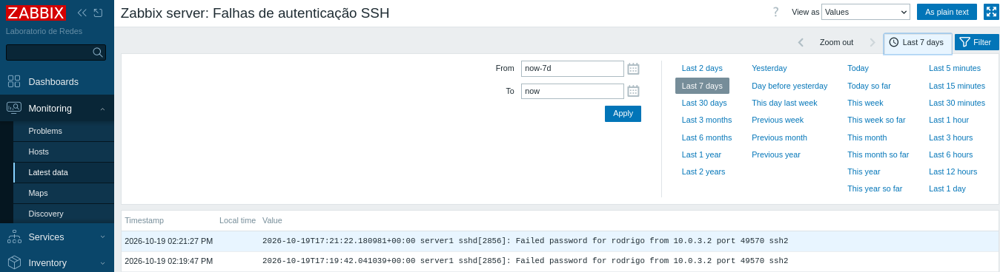
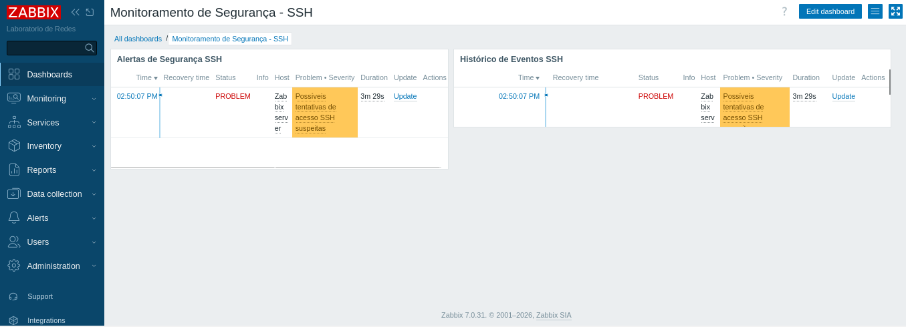
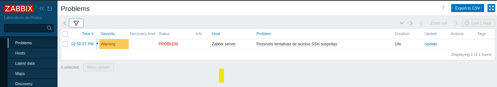
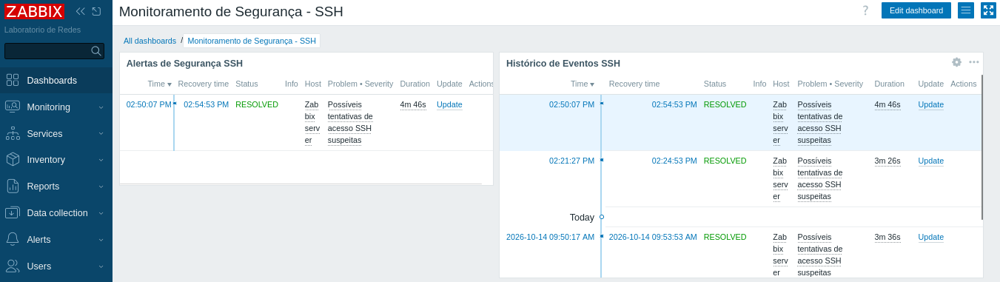

# Monitoramento de Segurança SSH com Zabbix e pfSense

## Sobre o projeto

Laboratório prático desenvolvido no VirtualBox para monitorar falhas de autenticação SSH em um servidor Linux utilizando o Zabbix. O objetivo foi configurar a coleta de logs, criar uma regra de detecção e validar o ciclo de vida de um alerta de segurança.

## Objetivos

- Centralizar o monitoramento do servidor Linux no Zabbix.
- Monitorar falhas de autenticação SSH.
- Criar um gatilho para detectar possíveis tentativas suspeitas de acesso.
- Validar a geração e a recuperação de alertas.
- Praticar análise de logs e troubleshooting.

## Tecnologias utilizadas

- Oracle VirtualBox
- pfSense CE 2.8.1
- Ubuntu Server 24.04.4 LTS
- Zabbix 7.0 LTS
- Zabbix Agent 2
- SSH e logs do Linux
- ACLs e logrotate

## Arquitetura

O laboratório utiliza redes virtuais separadas para clientes, servidores e conectividade externa.

- **pfSense:** roteamento, segmentação e controle de tráfego.
- **Ubuntu Server:** servidor monitorado e ambiente do Zabbix.
- **Zabbix Server:** coleta de dados, avaliação de gatilhos e exibição de eventos.
- **Cliente de teste:** utilizado para gerar eventos controlados de autenticação SSH.

O Zabbix coleta os eventos correspondentes no arquivo `/var/log/auth.log` por meio do agente ativo.

## Implementação

### 1. Configuração da coleta de logs

Foi criado o item `Falhas de autenticação SSH`, do tipo `Zabbix agent (active)`, com tipo de informação `Log`.

A chave configurada foi:

```text
log[/var/log/auth.log,"sshd.*(Failed password|authentication failure|Invalid user|message repeated.*Failed password)",,,skip]
```

A expressão filtra registros relacionados a falhas de senha, falhas de autenticação, usuários inválidos e mensagens agregadas de tentativas repetidas.

### 2. Permissões de leitura

Foi verificado o acesso do usuário `zabbix` ao arquivo de autenticação. Uma ACL foi aplicada para permitir a leitura do log sem conceder permissões desnecessárias a todos os usuários.

Também foi ajustada a configuração de `logrotate` para preservar a permissão de leitura após a rotação do arquivo.

### 3. Configuração do gatilho

Foi criado o gatilho `Possíveis tentativas de acesso SSH suspeitas`, com severidade `Warning`.

A regra utiliza a função `count()` para avaliar a quantidade de registros recebidos em uma janela de cinco minutos.

Expressão configurada:

```text
count(/Zabbix server/log[/var/log/auth.log,"sshd.*(Failed password|authentication failure|Invalid user|message repeated.*Failed password)",,,skip],5m)>=3 and nodata(/Zabbix server/log[/var/log/auth.log,"sshd.*(Failed password|authentication failure|Invalid user|message repeated.*Failed password)",,,skip],5m)=0
```

A condição considera os registros que correspondem ao filtro do item. Portanto, a quantidade de registros não equivale necessariamente à quantidade exata de tentativas de login: algumas tentativas podem gerar mais de uma mensagem, e o sistema pode agregar mensagens repetidas.

## Testes realizados

| Teste | Resultado |
|---|---|
| Coleta de logs SSH | Validada |
| Registro de falhas de autenticação | Validado no histórico do item |
| Ativação do gatilho | `PROBLEM` |
| Recuperação do evento | `Resolved` |

As tentativas de autenticação foram realizadas de forma controlada no ambiente virtual de laboratório.

## Evidências do laboratório

### 1. Coleta de logs SSH

O Zabbix recebe os registros de falhas de autenticação do Ubuntu Server por meio do agente ativo.



### 2. Alerta no dashboard de segurança

O dashboard apresenta o alerta relacionado a possíveis tentativas suspeitas de autenticação SSH.



### 3. Gatilho acionado

A tela de problemas do Zabbix confirma a ativação do gatilho com severidade Warning.



### 4. Recuperação do alerta

Após o encerramento do teste, o alerta foi apresentado como resolvido no dashboard.


## Competências praticadas

- Monitoramento de infraestrutura com Zabbix.
- Coleta e filtragem de logs Linux.
- Configuração do Zabbix Agent 2.
- Criação e validação de gatilhos.
- Gerenciamento de permissões com ACLs.
- Análise de eventos de autenticação SSH.
- Diagnóstico de problemas de coleta e monitoramento.

## Conclusão

O laboratório demonstrou a coleta de eventos de autenticação SSH, a detecção de condições suspeitas por meio de um gatilho e a recuperação de um alerta no Zabbix.

O projeto é educacional e não substitui uma solução completa de segurança. Em produção, a regra deve ser validada para reduzir falsos positivos, considerar a agregação de logs e definir critérios de recuperação adequados.

## Ambiente

Projeto pessoal de estudos em infraestrutura de redes, Linux e monitoramento.

**Autor:** Rodrigo Rosadini
